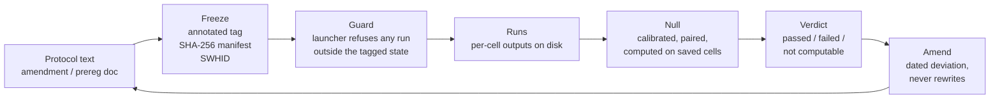

# 3. The chain: freeze, guard, null, amend

The chain is four links, each a small piece of code or a dated document,
each public in one of the Hypneum Lab repositories. None of them is
original on its own. Their value is that each one refuses something the
previous one cannot refuse, and that the whole was built by one person
while agents were producing experiments faster than that person could
read them. This section describes each link with the code that
implements it in the repository where it is most mature, its cost, and
the failure it was built against. Line counts and commit identifiers are
those of 2026-10-31; every excerpt is quoted from the committed source.

Figure 1 gives the order of the links and what each one consumes.



*Figure 1. The four links. A verdict never feeds back into the protocol
directly: it goes through a dated amendment, which is then frozen again.*

## 3.1 Freeze: a tag, a manifest and an identifier

A freeze is an annotated git tag whose message names the manifest file
and its SHA-256, computed from the file as it exists in the tagged
commit. The manifest lists the protocol files and their hashes. A
Software Heritage identifier (SWHID) of the tagged revision is then
recorded, because a git date is a field anyone can set.

The form was fixed in nerve-wml for the N10-C campaign. The helper that
produces a freeze refuses the obvious mistakes before the tag exists
(`experiments/procgen_multiagent_gtm_comm/campaign/freeze_prepare.py`):

```python
def prepare(repo: Path, tag: str, manifest_name: str | None = None,
            write_manifest: Callable[[Path, str], None] | None = None,
            registration: str = guards.DEFAULT_REGISTRATION) -> dict:
    """Rewrite the amendment status and regenerate the manifest in ``repo``
    (paths from the registration; never a path of ``guards.FROZEN_PATHS``)."""
    repo = Path(repo)
    reg = guards.registration(registration)
    if not guards.valid_tag_name(tag, reg.name):
        raise ValueError(f"invalid freeze tag {tag!r} for {reg.name}")
    manifest_name = manifest_name or reg.manifest_name
    if "DRAFT" in manifest_name:
        raise ValueError("a frozen manifest file name must not contain DRAFT")
```

The manifest itself is trivial. The bouba_sens version
(`scripts/sha256_manifest.py`, 59 lines) walks a directory and writes a
sorted mapping of relative path to size and digest:

```python
def build_manifest(root: Path) -> dict[str, dict[str, int | str]]:
    """Collect a mapping `relative_path -> {size, sha256}` under `root`."""
    entries: dict[str, dict[str, int | str]] = {}
    for ext in ("*.json", "*.csv", "*.png"):
        for path in sorted(root.rglob(ext)):
            if path.name == "MANIFEST.json":
                continue
            rel = path.relative_to(root).as_posix()
            entries[rel] = {"size": path.stat().st_size, "sha256": _sha256(path)}
    return dict(sorted(entries.items()))
```

Table 1 lists every freeze tag in the five repositories on 2026-10-31.
Twenty-two tags were created in eight days, 24 to 31 October 2026. The
column "SWHID recorded" says whether the identifier is written in a
committed document of the repository, which is the only form that
counts; an identifier that exists on the Software Heritage side but is
not written down in the repository is marked "not recorded".

*Table 1. Freeze tags on 2026-10-31. Commit = tagged commit (short).
Manifest = file named in the tag message or in the preregistration
document; digest = first eight hex characters of its SHA-256.*

| Repository | Tag | Commit | Date | Manifest (digest) | SWHID recorded |
|---|---|---|---|---|---|
| nerve-wml | `n10c-freeze-20261024` | `2ce4214` | 2026-10-24 | `stage2-manifest.md` (`1bddf9ca`) | yes, `swh:1:rev:2ce4214b…` |
| nerve-wml | `n10c-freeze-20261029` | `99a7cf4` | 2026-10-29 | `stage2-manifest-fixc.md` (`68539232`) | yes, rev `99a7cf4b…`, snp `01242c8b…` |
| nerve-wml | `prereg-nh01-hopfield-dream-20261025` | `bc2f838` | 2026-10-25 | prereg file (`b1ccbb63`) | not recorded |
| nerve-wml | `prereg-nh01-confirmatory-20261025` | `a000f73` | 2026-10-25 | prereg file (`6c29566b`) | not recorded |
| nerve-wml | `prereg-nh01-correlated-20261027` | `df9a1e7` | 2026-10-27 | prereg file (`be9ef311`) | not recorded |
| dream-of-kiki | `prereg-nh03-20261025` | `31412c9` | 2026-10-25 | to verify | not recorded |
| dream-of-kiki | `prereg-nh03-sched-20261027` | `6364719` | 2026-10-27 | to verify | not recorded |
| dream-of-kiki | `prereg-nh03-deferred-20261030` | `aa80d1f` | 2026-10-30 | to verify | not recorded |
| bouba_sens | `prereg-b3-probe-v2-20261025` | `1d96a65` | 2026-10-25 | to verify | not recorded |
| bouba_sens | `prereg-b3-lesion-interaction-20261027` | `37810b5` | 2026-10-27 | to verify | not recorded |
| bouba_sens | `bouba_sens/v0.7-actionsense-prereg` | `02c2407` | 2026-10-30 | `docs/prereg/actionsense-v0.7/freeze-manifest.md` (`b8010424`) | yes, `swh:1:rev:02c24073…` (session record; to verify in repo) |
| bouba_sens | `prereg-me6-large-n-20261031` | `b790db2` | 2026-10-31 | `docs/prereg/me6-large-n/freeze-manifest.md` | yes, `swh:1:rev:b790db27…` (session record; to verify in repo) |
| kiki-flow-research | `prereg-turing-strong-20261026` | `681c966` | 2026-10-26 | to verify | not recorded |
| kiki-flow-research | `prereg-turing-strong-implicit-20261027` | `eee124f` | 2026-10-27 | to verify | not recorded |
| kiki-flow-research | `prereg-m5-certify-20261030` | `f2f146e` | 2026-10-30 | `docs/prereg/2026-10-30-m5-certify-reading-rule.md` | not recorded |
| kiki-flow-research | `prereg-jko-splitting-20261030` | `09ec144` | 2026-10-30 | prereg, driver and schemes digests in the prereg doc | not recorded |
| micro-kiki | `prereg-nh81-20261025` | `52461ee` | 2026-10-25 | to verify | not recorded |
| micro-kiki | `prereg-nh81-kxkm-20261028` | `e85cdb8` | 2026-10-28 | to verify | not recorded |
| micro-kiki | `prereg-nh81-kxkm-20261028-r2` | `4189967` | 2026-10-28 | to verify | not recorded |
| micro-kiki | `prereg-nh81-kxkm-20261029-r3` | `c4eb859` | 2026-10-29 | to verify | not recorded |
| micro-kiki | `prereg-nh81-kxkm-20261030-r4` | `979771f` | 2026-10-30 | to verify | not recorded |
| micro-kiki | `prereg-nh81-m3pro-20261030` | `4b4dafd` | 2026-10-30 | to verify | not recorded |

Two observations on the table. First, the only repository where the
SWHID is systematically written down is nerve-wml, where the launcher
demands it (section 3.2); elsewhere the identifier was obtained or not,
and the repository does not say. Second, micro-kiki carries six tags for
one hypothesis (NH-81) in six days: four of them are relaunches on the
same host after infrastructure failures, each refrozen because the
protocol file had changed. That is the chain working as intended and it
is also its cost. One protocol lock is not a tag at all: E1-small in
dream-of-kiki is locked by the merge commit `963bb24` and the manifest
digest `6d47d8b7…` cited in its amendment of 2026-10-30, not by an
annotated tag. The chain tolerates this; the guard does not exist in
that repository.

**Cost.** A freeze takes between ten minutes and an hour of the PI's
time: regenerate the manifest, read the diff, write the tag message,
push, request the Software Heritage archival, write the identifier
down. The time is mostly reading.

**Failure mode it was built against.** The N10-C campaign of 2026-10-24
was launched from a working tree whose protocol document was still
being edited by an agent. The first freeze (`n10c-freeze-20261024`)
was created after the fact to pin what had actually been run, and the
amendment of 2026-10-25 records that the stage-2 manifest of that tag
did not cover one file that the run read. The second freeze
(`n10c-freeze-20261029`) is the corrected one. The tag did not prevent
the error; it made it describable with a commit identifier.

## 3.2 Guard: the launcher refuses

A guard is code in the launch path that refuses to run anything the
freeze does not allow. The nerve-wml implementation
(`campaign/guards.py`, 890 lines) is the most complete. Three constants
define the boundary:

```python
REGISTERED_BUDGET = 50_000_000
HELD_OUT_START = 1000
HELD_OUT_RANGE = range(1000, 1200)
DEV_MAX_PAIR_STEPS = 1_000_000  # development / smoke cap (amendment: <= 1M)
# Learnability-gate dev runs (kind gate_dev) may run longer: the Adam study's
# 10M runs (PI decision 2026-10-25 13:33), matching devledger.GATE_MAX_STEPS.
GATE_DEV_MAX_PAIR_STEPS = 10_000_000
```

A training run either has a freeze context, in which case it must match
the registered budget, configuration and per-host settings exactly, or
it has none, in which case it is capped at one million pair-steps (ten
million for the learnability gate):

```python
    if ctx is None:
        cap = dev_max_pair_steps(dev_kind)
        if total_pair_steps > cap:
            raise GuardError(
                f"training with {total_pair_steps:,} pair-steps refused: the "
                f"development mode ({dev_kind}) is limited to {cap:,}; "
                "larger runs need the registered path (freeze-tag context)")
        return None
    _need_ctx(ctx, "registered training")
    reg = registration(ctx.registration)
    errs = registered_run_problems(
        arm=arm, seed=seed, condition=condition, total_pair_steps=total_pair_steps,
        settings=settings, config=config, registration=reg.name)
    if has_env_factory:
        errs.append("a registered run uses the real Procgen (no env_factory)")
```

The freeze context is itself checked. The function below is the one
that makes the tag message load-bearing: it reads the manifest from the
tagged commit, not from the working tree, and compares its digest with
the one written in the tag:

```python
    if not freeze_tag:
        return ["--freeze-tag missing: the annotated freeze tag is mandatory "
                "for every registered launch and held-out evaluation"]
    commit, probs = freeze_tag_info(repo, freeze_tag, registration_name)
    ...
    if not swhid:
        bad.append("--swhid missing: the Software Heritage identifier of the "
                   "tagged state is required")
    elif not SWHID_RE.match(swhid):
        bad.append("--swhid is not a valid swh:1:(snp|rev|dir):<40 hex> identifier")
    ...
    tagged = _git_bytes(repo, "show", f"{commit}:{rel}")
    if tagged is None:
        return bad + [f"manifest {rel} is not in the tagged commit {commit}"]
    digest = hashlib.sha256(tagged).hexdigest()
    if digest != msg_sha:
```

The same file records, best effort, the server-side push time of the
tag from the GitHub events feed (`github_push_time`), because the
amendment convention of the lab is that a document is dated by the push
time of its first commit, not by the author date.

Only nerve-wml has a guard of this kind. kiki-flow-research has a
reading rule fixed before any result existed (the M5 rule of
2026-10-30, "one uncertified configuration in this stratum makes the
primary verdict `failed`"), which is a guard on the reading, not on the
launch. bouba_sens, dream-of-kiki and micro-kiki have no launch guard:
their freezes are enforced by the PI reading the tag before typing the
command.

**Cost.** The nerve-wml guard was written over four days (2026-10-23 to
2026-10-27) and is the single largest piece of non-experimental code in
the campaign. Every change to the protocol requires a change to the
guard's registration table, which is why the N10-C protocol was frozen
twice. Each refusal costs a relaunch.

**Failure mode it was built against.** Agents iterate for free. Before
the guard, a run of fifty million pair-steps and a smoke run of ten
thousand went through the same function with the same defaults, and the
record of which was which lived in a chat transcript. The one-million
development cap and the mandatory tag context mean that any registered
run is, by construction, one that the frozen protocol describes.

## 3.3 Null: calibrated and paired, on the saved cells

A null is a distribution of the test statistic under the hypothesis of
no effect, computed from the same pipeline and, where the design is
paired, from the same cells. It exists so that a threshold means
something before the word "passed" is written. The lab's rule, fixed
after the external critique of 2026-10-25 (section 4), is that a verdict
requires a same-pipeline null, that a control must be able to fail, and
that a ratio with a near-zero denominator is reported as "not
computable" rather than as a number.

The bouba_sens implementation (`scripts/me6_paired_null.py`, 527 lines)
is the reference. The B-3 statistic Me6 is the largest signed
asymmetry between two modalities over a five-by-five matrix of lesion
and query. The paired null flips, item by item, the sign of each
difference, which is the swap of the two cells of the pair:

```python
def pair_differences(successes: np.ndarray) -> np.ndarray:
    """`d[..., pair, i] = s[a, b, i] - s[b, a, i]` for the 10 pairs a < b."""
    if successes.shape[-3:-1] != (N_MODALITIES, N_MODALITIES):
        raise ValueError(f"expected (..., 5, 5, n); got {successes.shape}")
    return (successes[..., _IU, _JU, :] - successes[..., _JU, _IU, :]).astype(np.int8)


def me6_from_successes(successes: np.ndarray) -> np.ndarray:
    """Observed Me6 per trio: `max_pairs |mean_i d|`. Input `(..., 5, 5, n)`."""
    signed = pair_differences(successes).mean(axis=-1)  # (..., 10)
    return np.abs(signed).max(axis=-1)
```

The replicate count and seed are fixed in the file (B = 20 000, seed
25102026) and the RNG is chunked so that a given seed reproduces the
same draws whatever the chunk size. The block option exists because the
Studyforrest probes are contiguous windows and items are not
exchangeable:

```python
    `block > 1` flips consecutive items in blocks of that length with one
    shared sign (block sign flip, ADR-0022 follow-up 2): for probes that
    are contiguous temporal windows (Studyforrest worlds) the items are not
    exchangeable, and a block at least as long as the correlation length
    keeps the within-block dependence. `block = 1` is the per-item flip and
    reproduces the draws of earlier runs exactly.
```

The null runs on `per_query_successes.json` files already on disk. It
costs seconds and no GPU. That is the point: a null that needs a new
run is a null that will be skipped.

**Cost.** Writing the first paired null took one day (2026-10-25); the
block variant, half a day. Reading its output against the observed
statistic takes minutes. The real cost is earlier: the per-cell outputs
must have been saved in a form that allows the recomputation, which was
not the case for the first B-3 grids.

**Failure mode it was built against.** The B-3 verdict had been
reported as passed on a statistic whose null expectation, recomputed
analytically by the external reviewer on 2026-10-25, lay in 0.10 to 0.17
against a threshold of 0.02. The threshold had been chosen without any
null. The same review found that twenty-five of twenty-five false
positives in a control had been reported as rejected when they were
not. Neither error required new compute to find; both required a null
to prevent.

## 3.4 Amend: dated, before the relaunch, never rewriting

An amendment is a dated document that records a deviation from the
frozen protocol, what it changes, what it does not change, and the new
freeze that follows. The lab has fifteen amendment files on 2026-10-31
(dream-of-kiki four, nerve-wml six, bouba_sens four, micro-kiki one),
plus one strong-Turing excess note in kiki-flow-research that plays the
same role. Three rules govern them.

The amendment is written before the relaunch, not after the result.
The micro-kiki amendment of 2026-10-28 is the counter-example recorded
in its own text: it was written after the measurement it amends, and
says so. The N10-C amendments of 2026-10-23, 2026-10-25 and 2026-10-30
each precede the run they describe.

The amendment is dated by the push time of its first commit, which the
guard records when it can (`github_push_time`), because author dates
are editable. Where the push time was not obtained the document says
"not recorded".

The amendment never rewrites. A past artefact that turns out to be
wrong is corrected by a new dated document that points to it (section
4); the old file keeps its content and gains a status line. The
bouba_sens ADR-0020 states the rule in one sentence: "It does **not**
change any published number, ADR verdict or locked pre-registration,
and this ADR edits none of them."

**Cost.** An amendment is one to three hours of writing, plus the
refreeze. On 2026-10-30, the Lie/Strang splitting campaign in
kiki-flow-research errored on 261 jobs because a job runner called
`os.nice` without permission; the PI's decision was to stop, fix,
declare the deviation in a dated amendment, and relaunch under a new
tag. The fix was one line; the amendment and refreeze took the rest of
the hour (to verify: amendment file and new tag not yet in the clone of
2026-10-31).

**Failure mode it was built against.** A protocol that can be edited
silently is not a protocol. The dream-of-kiki power statement for G4
and G5-bis, 0.74, was copied unchanged into six locked sentences after
the significance level had been changed (erratum of 2026-10-28). An
amendment at the time of the change would have caught it; the erratum
caught it ten days later.

## 3.5 What the chain does not do

The chain cannot save a measurement that does not measure. The
micro-kiki energy figures (E-01, section 4) were analytical estimates
presented as measurements; no tag, guard or null would have flagged
them, because the pipeline that produced them was frozen and reproduced
faithfully. The chain cannot replace an external replication: NH-01
replicates Fachechi, Agliari and Barra bit-exactly at two loads, and
that is a statement about the lab's code, not about the phenomenon.
And the chain is only as complete as its weakest repository: on
2026-10-31, one repository of five has a launch guard, one has a
systematic SWHID record, and one has a paired null. The others have the
tags and the amendments, enforced by one person reading.
